# LumenCross 작업 현황판

홈페이지: https://ju00moon-sketch.github.io/LumenCross/

LumenCross(루멘 크로스) 개발 진행을 대표와 팀이 한곳에서 보기 위한 정적 페이지입니다. 페이지는 손으로 고른 공개용 자료에서 생성하며, 이 저장소의 파일을 직접 고치지 않습니다.

페이지 상단에서 다음 내용을 선택할 수 있습니다.
- `index.html`: 작업 현황. 지금 하는 일만 둡니다: 역할별 활동, 대표가 보실 것의 건수와 가는 길, 기준선과 저장소 상태(아직 안 된 것, 기준 문서 버전, 다음 단계), 레인별 작업 현황, 열린 반례.
- `review.html`: 기획 검토. 대표를 기다리는 것을 모두 둡니다: 대표가 답하실 것, 총괄이 정해 보고하는 것, 새로 받은 기획의 검토(요약, 쟁점·총괄 반박·게임디자인 의견·합의, 최종안, 확인받을 항목).
- `closed.html`: 완료·종결. 끝난 것을 모두 둡니다: 완료한 작업, 답변으로 종결된 대표 결정, 총괄이 정리해 닫은 보고, 답변이 끝난 기획 검토, 종결된 반례, 검증 기록, 변경 기록.
- `contractors.html`: 계약자 도감. 지역별 계약자와 병과, 스킬 기획.
- `items.html`: 아이템 백과. 시험용 표본·검토 대기 후보·비판매 공통 규칙의 기획 ID, 아이콘, 가격, 완성 능력치, 효과와 조합식. 아이콘 수령 현황과 남은 기획.
- `art.html`: 아트. 중간 보고, 제작한 그림·동작과 회전·확대할 수 있는 3D 모델.
- `screenshots.html`: 게임 화면. 미러시티 구조물 배치와 구간별 근접 사진, 경기 관전, UI·HUD 촬영본을 구분합니다. 이미지를 선택하면 원본 크기로 볼 수 있습니다.

기계용 요약은 `status.json`입니다. 작업 현황 탭은 공개 저장소의 최신 `activity.json`에서 역할별 상태와 마지막 활동 시각을 1분마다 읽습니다. 활동만 바뀌면 게임 이미지·모델이나 사이트 전체를 다시 배포하지 않습니다. 보고와 에셋은 검토 후 별도로 게시합니다.

규칙
- 탭은 실제 링크이며 키보드 Enter, 뒤로 가기, 직접 주소 열기를 지원합니다.
- 대표의 답을 기다리는 질문은 기획 검토 탭의 대표가 답하실 것 칸 한곳에만 둡니다. 결정 자료는 질문, 추천안과 이유, 대안, 플레이 차이, 구현·다른 설계 영향, 결정 시점, 숫자 상태의 7항목으로 적습니다.
- 대표가 실제로 답한 결정과 검토만 답변과 함께 완료·종결 탭의 답변 칸으로 옮깁니다. 일이 끝났거나 뒤 카드로 대체된 총괄 결정 보고는 총괄이 닫은 까닭을 적어 따로 둔 칸으로 옮기며 대표의 답으로 적지 않습니다. 열린 항목은 완료·종결 탭에 나오지 않고, 종결된 항목은 다른 탭에 나오지 않습니다.
- 읽음 표시는 이 브라우저에만 저장되는 표시이며 답변이나 승인이 아닙니다. 열린 항목이 없으면 읽음 단추와 안 읽음 배지를 그리지 않습니다.
- 검증 기록에는 실제로 실행한 것만 적고, 확인한 범위를 함께 적습니다. 범위에 없는 것은 확인하지 않은 것입니다.
- 비어 있는 칸은 비어 있다는 문장으로 보이며, 자리만 채우는 카드는 만들지 않습니다.
- 근거 표는 1000px 이상에서는 표로, 그보다 좁은 화면에서는 행마다 열 이름이 붙은 카드로 보입니다.
- 화면 밝기는 기기의 밝은 화면·어두운 화면 설정을 따릅니다.
- 레인 이름은 역할 이름만 씁니다. 작업 PC의 경로, 사용자 이름, 전자우편 주소, 작업·메시지 식별자, 작업 도구의 제품 이름은 공개하지 않으며, 생성기가 이런 내용을 찾으면 페이지를 쓰지 않고 멈춥니다.

배포는 `.github/workflows/pages.yml`이 저장소 루트를 그대로 올리는 방식입니다.

## 게임 화면

<section id="mirror-city" aria-labelledby="mirror-city-h"><h2 id="mirror-city-h">미러시티 전경16장</h2>
<figure class="shot"><a href="assets/base-core-blue-after.png">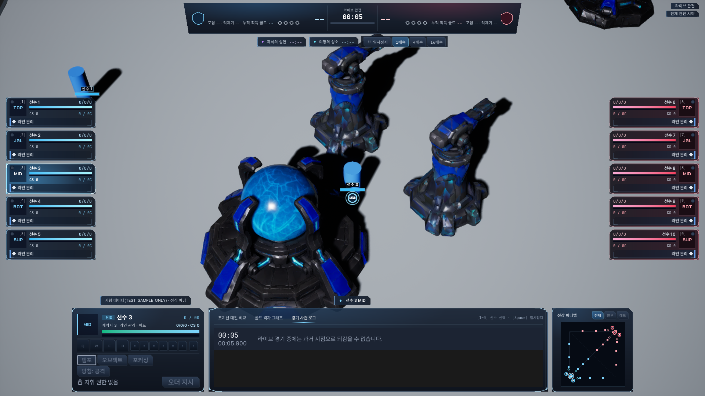</a><figcaption><h3>미러 시티 블루 본진 코어 · 확대 후</h3><time datetime="2026-11-26">2026-11-26</time>
1920×1080 100% HUD로 찍은 원본입니다. 블루 코어만 가로세로 각각 8⅓% 키운 뒤의 모습이며, 옆 포탑 두 기의 크기와 위치는 바뀌지 않았습니다. 표시 크기만 바꾼 것이고, 크기 비교용 시험 장면이라 최종 미술 평가나 공식 맵 도감이 아닙니다.
</figcaption></figure><figure class="shot"><a href="assets/base-core-red-after.png">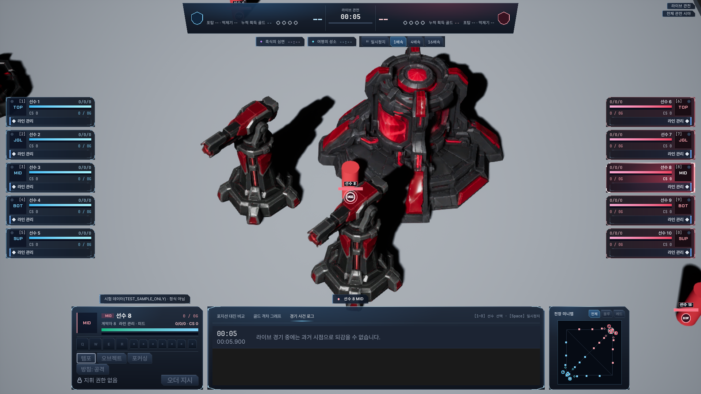</a><figcaption><h3>미러 시티 레드 본진 코어 · 확대 후</h3><time datetime="2026-11-26">2026-11-26</time>
1920×1080 100% HUD로 찍은 원본입니다. 레드 코어만 가로세로 각각 8⅓% 키운 뒤의 모습이며, 옆 포탑 두 기는 그대로입니다. 표시 크기만 바꾼 것이고, 크기 비교용 시험 장면이라 최종 미술 평가나 공식 맵 도감이 아닙니다.
</figcaption></figure><figure class="shot"><a href="assets/mirror-city-live-mid-towers.png">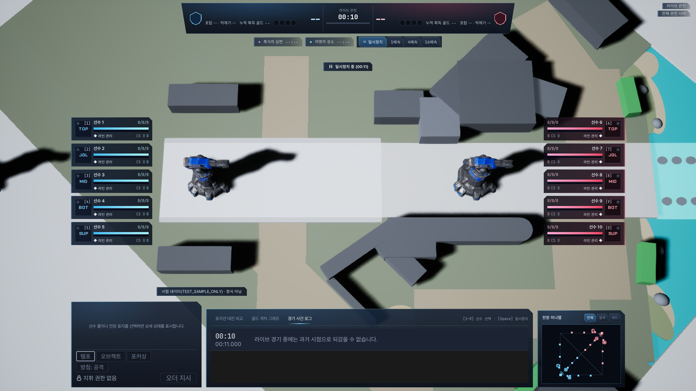</a><figcaption><h3>시험 경기 · 블루 미드 1차와 2차 포탑</h3><time datetime="2026-11-26">2026-11-26</time>
전체 관전 시야의 시험 경기를 11초에 멈추고, 일반 관전 카메라가 아닌 촬영 전용 카메라로 두 포탑을 한 화면에 담았습니다. 두 포탑의 중심 거리는 이번 시험 배치에서 약 2,051유닛이며, 길옆의 벽과 수풀은 완성 지형이 아닌 임시 형상입니다.
</figcaption></figure><figure class="shot"><a href="assets/mirror-city-live-core-twins.png">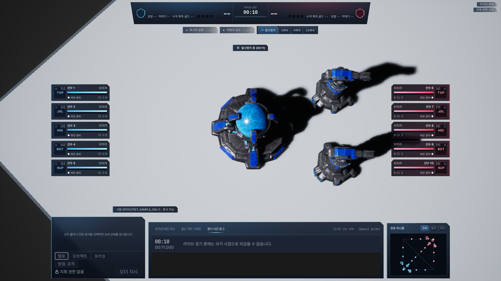</a><figcaption><h3>시험 경기 · 블루 코어와 쌍둥이 포탑</h3><time datetime="2026-11-26">2026-11-26</time>
같은 시험 경기의 11초 시점에 촬영 전용 카메라만 본진으로 옮겼습니다. 코어 앞에 붙인 쌍둥이 포탑 두 기가 모두 보이며, 회색 바닥은 위치를 확인하기 위한 임시 평면으로 완성 지형이 아닙니다.
</figcaption></figure><figure class="shot"><a href="assets/city-r3-blue-base.png">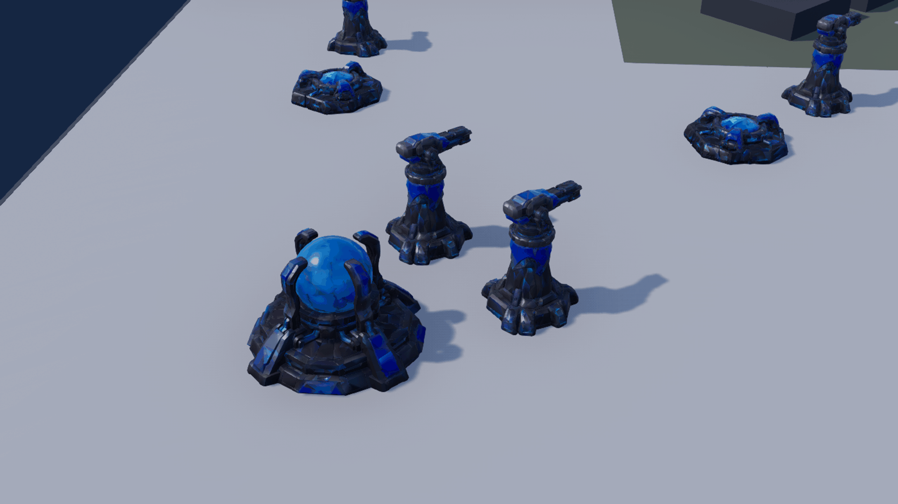</a><figcaption><h3>편집기 · 블루 본진 · 코어 쪽으로 옮긴 쌍둥이 포탑</h3><time datetime="2026-11-26">2026-11-26</time>
편집기에서 두 포탑을 코어 쪽으로 옮겨 찍은 정적 시험 배치 촬영본이며, 실제 경기 화면은 아닙니다. 코어 중심에서 각 포탑 중심까지는 약 703유닛이고, 본진 바닥은 위치 비교용 임시 평면입니다.
</figcaption></figure><figure class="shot"><a href="assets/city-r3-red-base.png">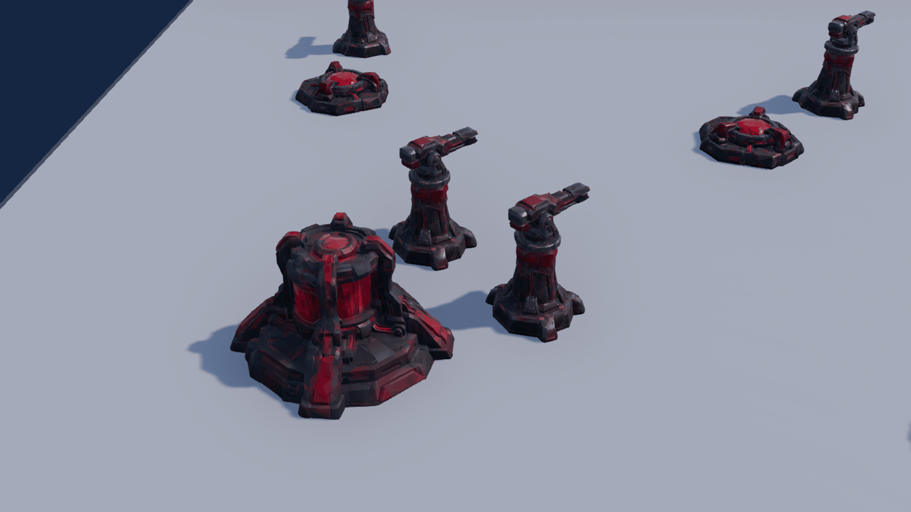</a><figcaption><h3>편집기 · 레드 본진 · 반대편에서 본 코어와 포탑</h3><time datetime="2026-11-26">2026-11-26</time>
편집기에서 레드 본진에도 블루와 대칭으로 두 포탑을 배치한 정적 촬영본이며, 실제 경기 화면은 아닙니다. 이 시험 배치에서 코어와 포탑은 이전 배치의 표시 크기보다 각각 8%, 15% 크게 두었고, 회색 바닥은 미제작 임시 평면입니다.
</figcaption></figure><figure class="shot"><a href="assets/city-r3-mid-towers.png">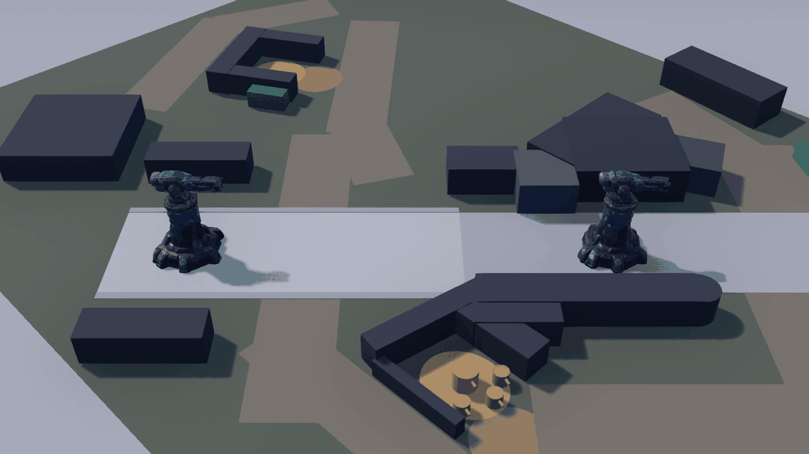</a><figcaption><h3>편집기 · 블루 미드 · 1차와 2차 포탑 사이</h3><time datetime="2026-11-26">2026-11-26</time>
편집기에서 두 포탑 사이를 넓혀 찍은 정적 시험 배치 촬영본이며, 실제 경기 화면은 아닙니다. 중심 사이 거리는 약 2,051유닛이고, 길옆의 벽·수풀·캠프 자리는 통로를 확인하기 위한 임시 형상입니다.
</figcaption></figure><figure class="shot"><a href="assets/city-r3-red-inhibitor.png">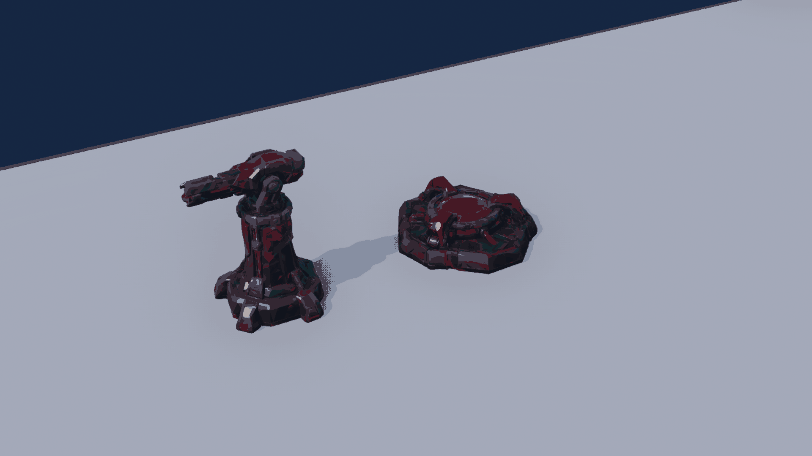</a><figcaption><h3>편집기 · 레드 탑 · 3차 포탑 옆 억제기</h3><time datetime="2026-11-26">2026-11-26</time>
편집기의 정적 시험 배치 촬영본이며 실제 경기 화면은 아닙니다. 포탑과 억제기의 중심 간격은 700유닛 그대로이고, 낮은 억제기는 이전 배치의 표시 크기보다 20% 크게 표시했습니다. 두 구조물이 놓인 회색 바닥은 완성된 탑 라인 지형이 아닙니다.
</figcaption></figure><figure class="shot"><a href="assets/city-structures-overview.png">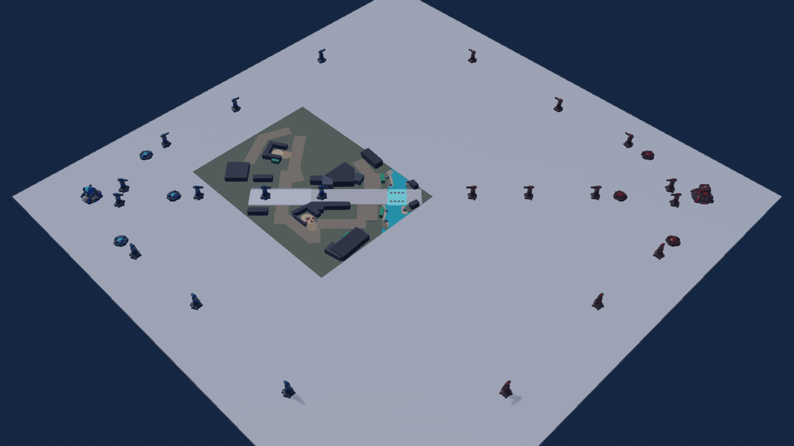</a><figcaption><h3>미러시티 전체 배치 · 블루 본진에서 레드 본진까지</h3><time datetime="2026-11-26">2026-11-26</time>
게임 엔진에서 두 본진과 세 라인의 구조물을 한 화면에 담았습니다. 포탑 22기, 억제기 6기, 코어 2기는 실제 팀 모델입니다. 가운데 미드 구간 바깥의 회색 바닥은 위치를 확인하기 위한 임시 평면으로, 완성 지형이 아닙니다.
</figcaption></figure><figure class="shot"><a href="assets/city-blue-core-twin-towers.png">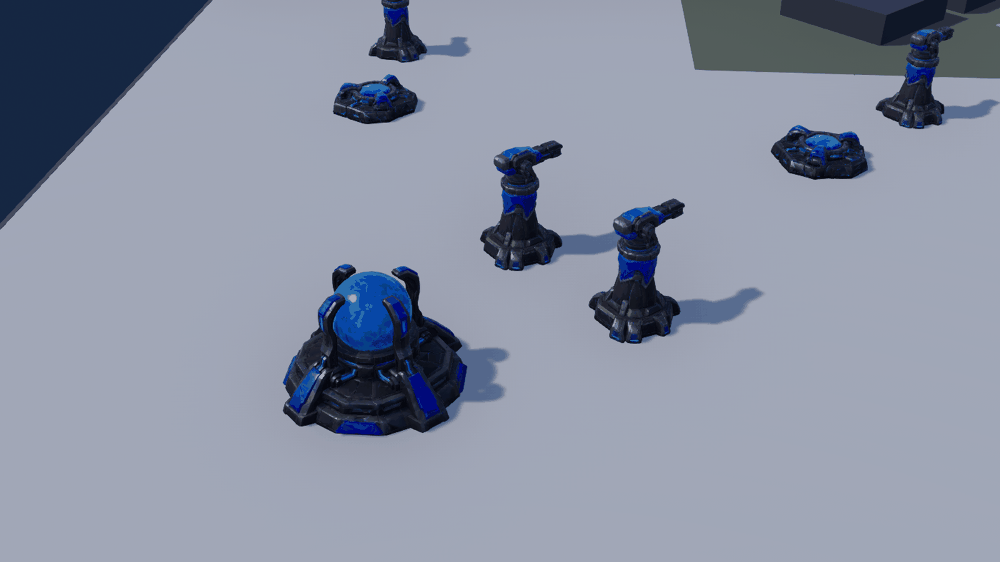</a><figcaption><h3>블루 본진 · 코어와 쌍둥이 포탑</h3><time datetime="2026-11-26">2026-11-26</time>
전체 배치 사진의 왼쪽 본진을 가까이서 찍었습니다. 코어와 포탑 두 기의 형태와 간격을 보여주는 촬영본입니다. 주변 본진 건물과 지형은 아직 제작 전입니다.
</figcaption></figure><figure class="shot"><a href="assets/city-red-inhibitor-lane.png">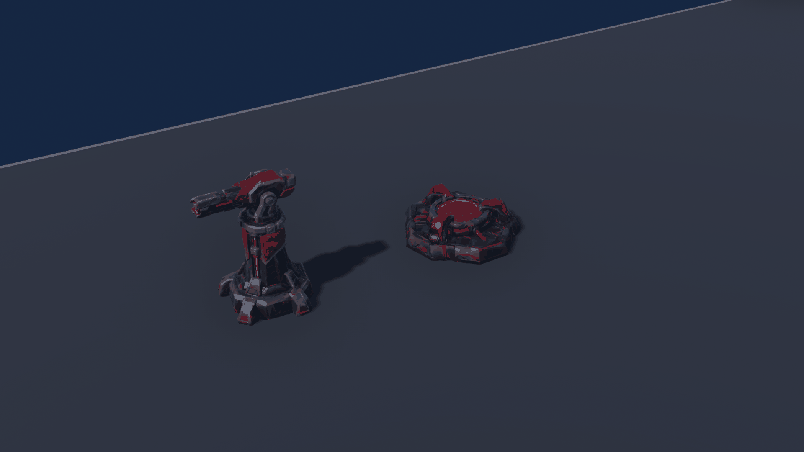</a><figcaption><h3>레드 탑 라인 · 억제기와 3차 포탑</h3><time datetime="2026-11-26">2026-11-26</time>
레드 탑 라인의 기지 쪽 두 구조물을 옆에서 찍었습니다. 높은 3차 포탑과 낮은 억제기의 위치 관계를 보여주는 사진이며, 이 구간에는 아직 길과 벽이 없습니다.
</figcaption></figure><figure class="shot"><a href="assets/city-mid-tower-jungle.png">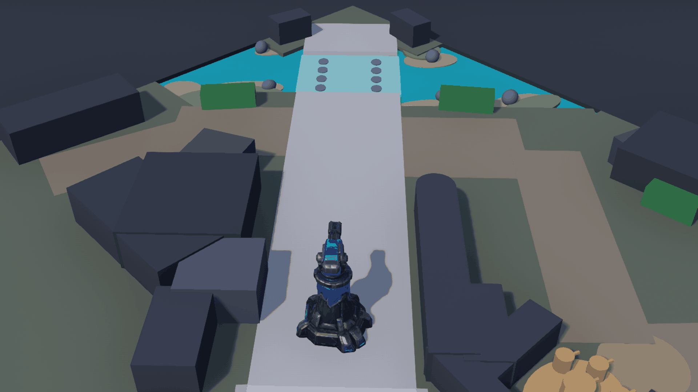</a><figcaption><h3>미드 1차 포탑에서 본 정글 입구와 여울</h3><time datetime="2026-11-26">2026-11-26</time>
블루 1차 포탑 뒤에서 강가를 향해 찍었습니다. 팀 포탑은 실제 모델이고, 길·암벽·수풀·첫 캠프는 위치와 통로 폭을 확인하는 임시 형상입니다.
</figcaption></figure><figure class="shot"><a href="assets/map07_r4_mid.png">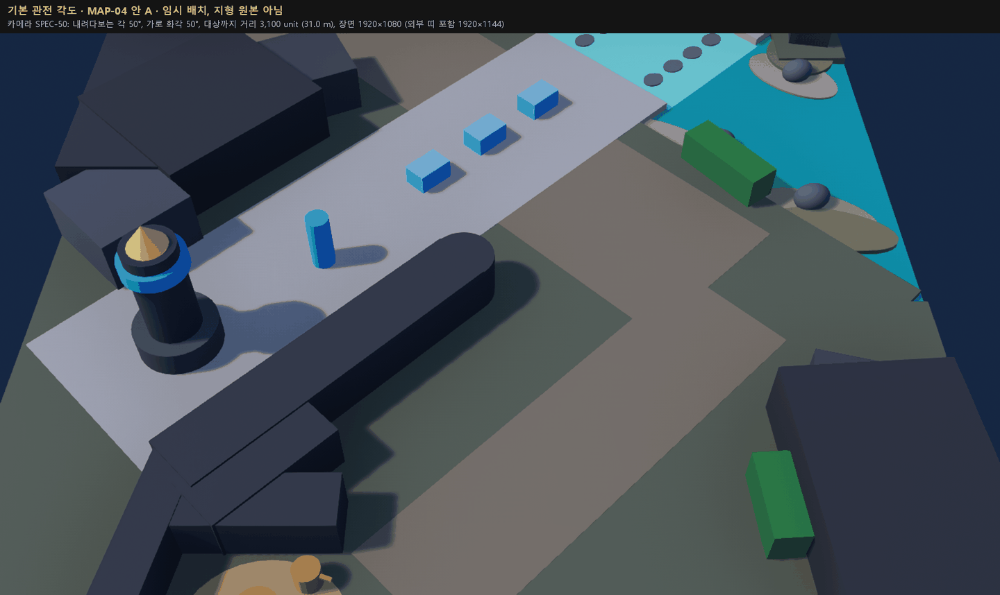</a><figcaption><h3>미드 길에서 강가까지 · 관전 시점</h3><time datetime="2026-11-25">2026-11-25</time>
게임 엔진에서 미러시티의 미드 구간을 관전 카메라로 찍었습니다. 원기둥은 계약자, 상자는 드론의 자리를 나타냅니다. 완성 모델을 배치한 경기 장면은 아닙니다.
</figcaption></figure><figure class="shot"><a href="assets/map08_overview_top.png">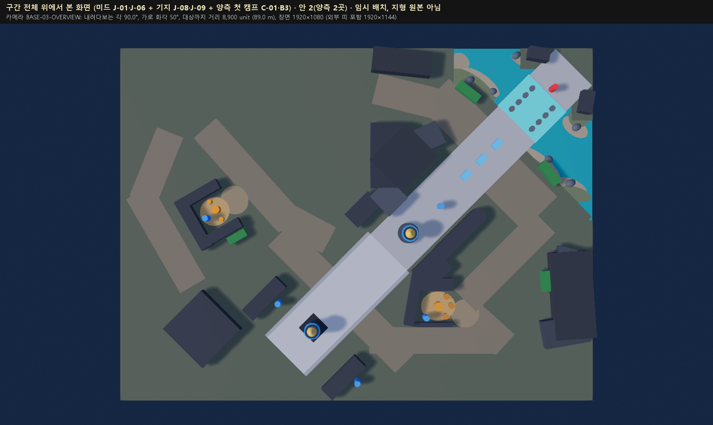</a><figcaption><h3>포탑 사이로 갈라지는 정글 입구 · 위에서 본 모습</h3><time datetime="2026-11-25">2026-11-25</time>
기지 쪽 정글 입구를 추가한 11월 25일의 구간 촬영입니다. 당시 대리 포탑 둘 사이에서 길이 갈라져 첫 캠프와 여울로 이어지는 모습을 위에서 볼 수 있습니다.
</figcaption></figure><figure class="shot"><figcaption><h3>남동 정글 입구에서 본 첫 캠프</h3><time datetime="2026-11-25">2026-11-25</time>
미드 1차와 2차 포탑 사이에서 남동쪽을 바라본 장면입니다. 정글에 들어설 때 첫 캠프가 어디에 보이는지 확인하려고 찍었습니다. 주황색 표시는 드론 모델이 아닙니다.
</figcaption></figure><figure class="shot"><a href="assets/map07_r4_ford.png">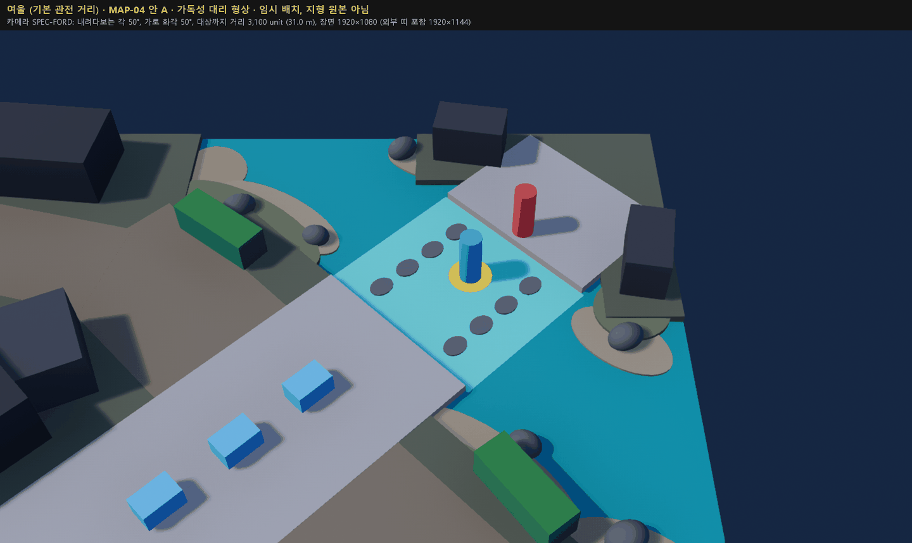</a><figcaption><h3>강을 건너는 여울과 양쪽 강둑</h3><time datetime="2026-11-25">2026-11-25</time>
미드 길에서 강을 건너는 자리를 관전 카메라로 찍었습니다. 두 줄의 돌판 사이가 여울이고, 강둑의 초록 상자는 수풀이 놓일 자리입니다.
</figcaption></figure>
</section>
<section id="spectating" aria-labelledby="spectating-h"><h2 id="spectating-h">경기 관전9장</h2>
<figure class="shot"><a href="assets/live-top-silhouette-1080.png">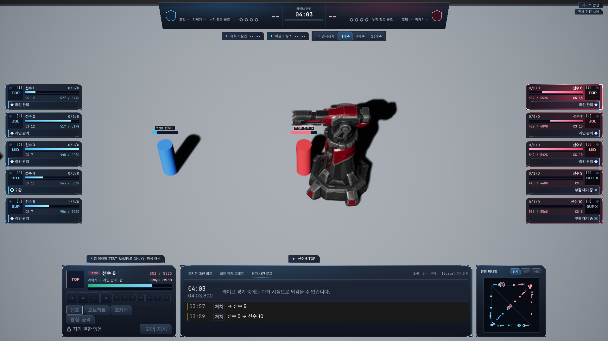</a><figcaption><h3>미러 시티 탑 교전 · 실루엣 위 체력판</h3><time datetime="2026-11-26">2026-11-26</time>
1920×1080 100% 원본입니다. 미러 시티 시험 경기 4분 3초 무렵 탑 라인에서 맞붙은 두 선수의 체력판이 몸 위에 겹치지 않고 떠 있는지 잰 장면으로, 잰 겹침은 0픽셀이었습니다. 시험용 편성이라 실제 경기 결과가 아니며, 계측이지 독립 시각 판정이 아닙니다.
</figcaption></figure><figure class="shot"><a href="assets/live-top-silhouette-720.png">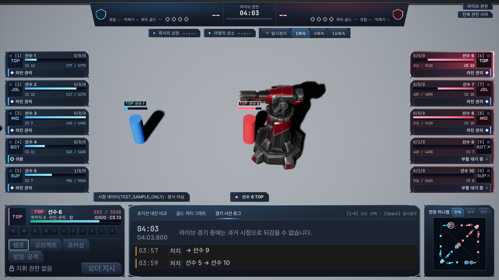</a><figcaption><h3>미러 시티 탑 교전 · 체력판 (작은 창)</h3><time datetime="2026-11-26">2026-11-26</time>
1280×720 100% 원본입니다. 같은 시점에 창만 줄여 찍었고, 체력판 크기는 줄지 않았으며 몸과의 겹침도 0픽셀이었습니다. 시험용 편성이라 실제 경기 결과가 아니며, 독립 시각 판정을 받지 않았습니다.
</figcaption></figure><figure class="shot"><a href="assets/live-bot-four-1080.png">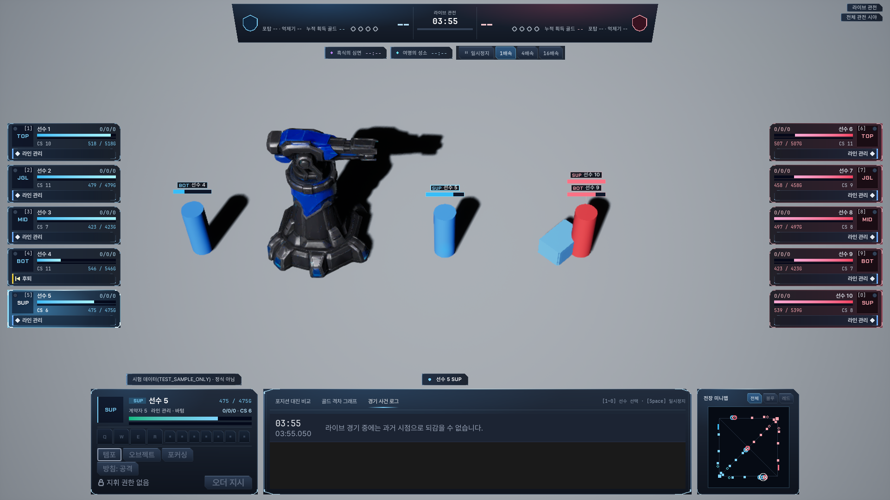</a><figcaption><h3>미러 시티 바텀 4인 교전 · 머리 위 체력판</h3><time datetime="2026-11-26">2026-11-26</time>
1920×1080 100% 원본입니다. 미러 시티 시험 경기 3분 55초에 바텀 라인에서 네 선수가 한 화면에 들어왔고, 체력판 네 개가 서로 겹치거나 몸을 덮지 않았습니다. 레드 두 선수는 실제로 같은 자리에 서 있어 몸이 윤곽 하나로 보입니다. 시험용 편성이라 실제 경기 결과가 아니며, 독립 시각 합격을 받지 않았습니다.
</figcaption></figure><figure class="shot"><a href="assets/live-bot-four-720.png">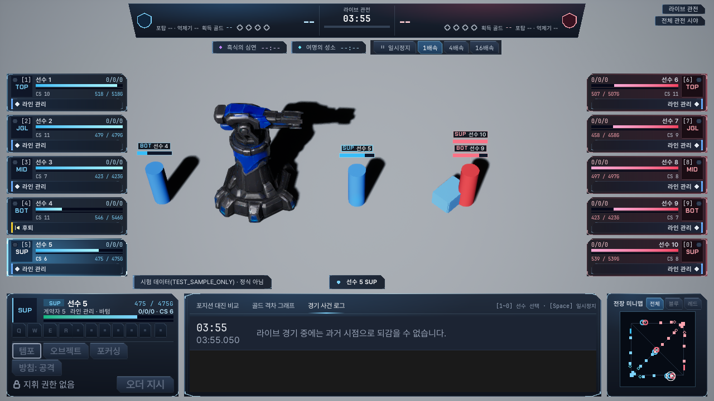</a><figcaption><h3>미러 시티 바텀 4인 교전 · 체력판 (작은 창)</h3><time datetime="2026-11-26">2026-11-26</time>
1280×720 100% 원본입니다. 같은 시점에 창만 줄여 찍었고 네 판이 잘리거나 겹치지 않았습니다. 레드 두 선수는 한 점에 서 있어 몸은 하나로 보이지만 판은 둘로 나뉩니다. 시험용 편성이라 실제 경기 결과가 아니며, 독립 시각 합격을 받지 않았습니다.
</figcaption></figure><figure class="shot"><a href="assets/mirror-city-first-purchase.png">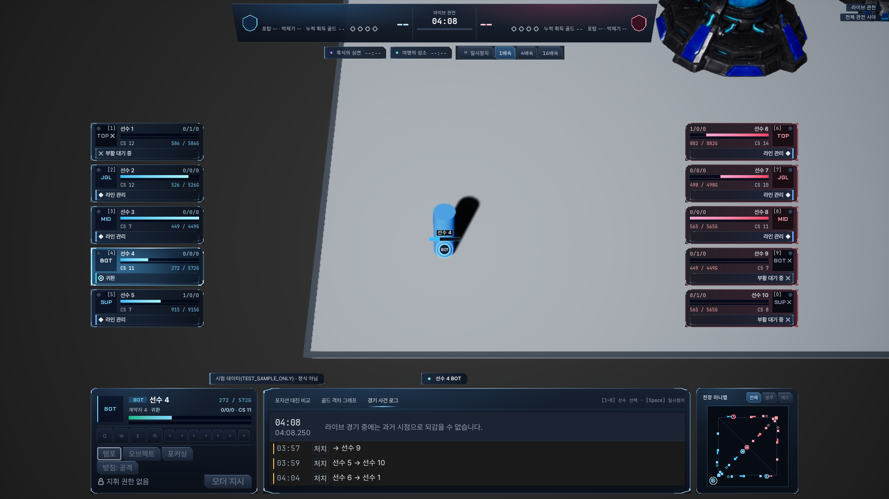</a><figcaption><h3>미러시티 시험 경기 · 첫 우물 구매와 보유·누적 골드</h3><time datetime="2026-11-26">2026-11-26</time>
전체 관전 시야의 시험 경기 04:08.250에 블루 하단 공격수가 우물에서 300골드를 지출한 직후 장면입니다. 해당 선수는 보유 272골드, 누적 획득 572골드, CS 11로 두 금액이 갈리지만, 나머지 아홉 명은 아직 지출 전이어서 열 명 전체가 서로 다른 수치를 보이는 화면은 아닙니다. 원기둥은 임시 선수 모델이고 회색 바닥은 미제작 임시 평면입니다.
</figcaption></figure><figure class="shot"><a href="assets/mirror-city-live-overview.png">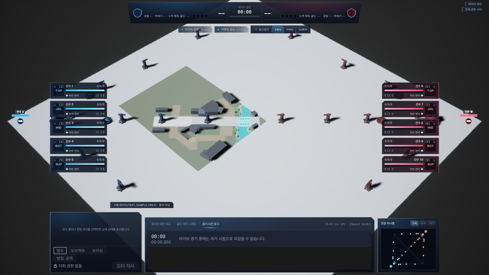</a><figcaption><h3>미러시티 시험 경기 · 중앙 라인 전경</h3><time datetime="2026-11-26">2026-11-26</time>
전체 관전 시야의 시험 경기를 시작한 지 0.2초에 관전 카메라로 찍었습니다. 중앙 라인과 물길 주변에만 임시 지형을 배치했고, 바깥의 회색 평면은 구조물 위치를 확인하는 임시 바닥입니다.
</figcaption></figure><figure class="shot"><a href="assets/mirror-city-live-blue-mid.png">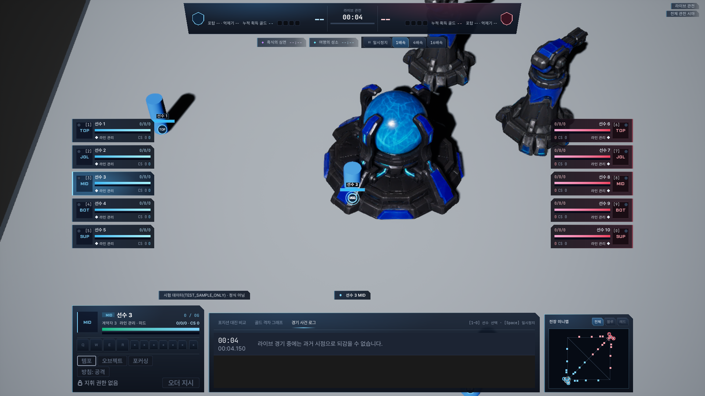</a><figcaption><h3>미러시티 시험 경기 · 블루 본진의 코어와 포탑</h3><time datetime="2026-11-26">2026-11-26</time>
같은 경기의 4.15초에 블루 미드 선수를 따라간 장면입니다. 코어 앞의 원기둥은 임시 선수 모델입니다. 포탑 일부가 화면 밖이나 선수 카드 뒤에 있어 이 장면만으로는 두 포탑 사이의 간격을 볼 수 없습니다.
</figcaption></figure><figure class="shot"><figcaption><h3>전장 전체 · 13:15, 처치 2 대 2</h3><time datetime="2026-11-25">2026-11-25</time>
기본 공격만 쓰는 5대5 시험 경기를 관전 창에서 찍었습니다. 선수 이름은 표본이지만 위치와 체력, 부활 대기 시간은 경기에서 계산한 값입니다.
</figcaption></figure><figure class="shot"><a href="assets/view02_end.png">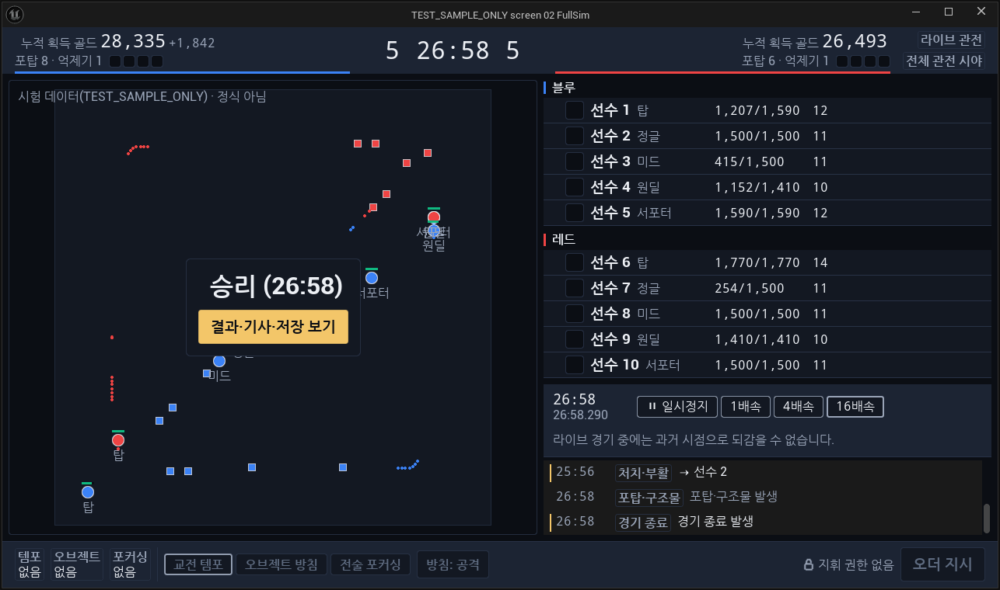</a><figcaption><h3>26:58 · 경기 종료</h3><time datetime="2026-11-25">2026-11-25</time>
같은 경기의 마지막 장면입니다. 두 팀이 다섯 번씩 처치했고 레드가 이겼습니다. 이 시험에서는 3D 전장 대신 위치 표지를 썼습니다.
</figcaption></figure>
</section>
<section id="interface" aria-labelledby="interface-h"><h2 id="interface-h">UI·HUD23장</h2>
<figure class="shot"><a href="assets/result-unsaved-1080.png">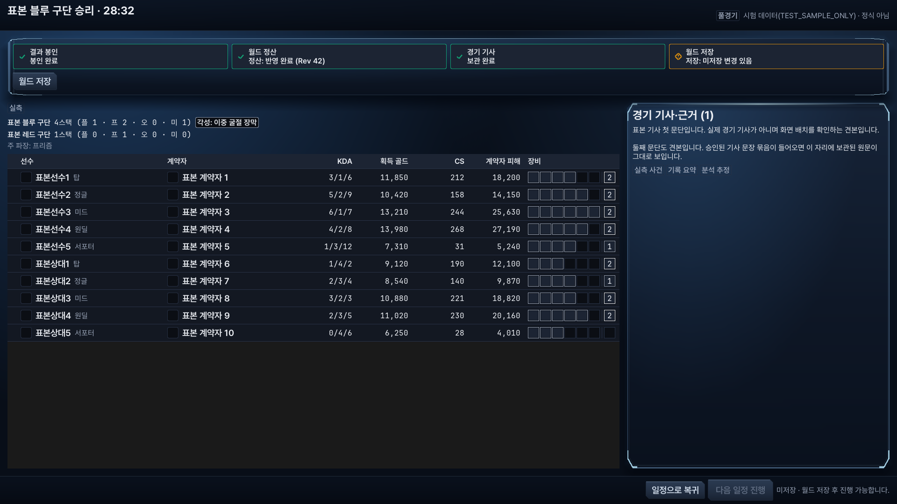</a><figcaption><h3>경기 결과 · 미저장 상태로 다시 연 화면</h3><time datetime="2026-11-27">2026-11-27</time>
1920×1080 100% 결과 화면입니다. 정산은 끝났지만 아직 저장하지 않은 단판 결과를 다시 연 상태로, 다음 일정 진행이 잠긴 이유를 단추 옆에 적었습니다. 표본 기록과 견본 기사라 실제 경기 결과가 아닙니다. 만든 담당이 직접 찍은 화면이며 독립 시각 검수는 아직 받지 않았습니다.
</figcaption></figure><figure class="shot"><a href="assets/result-unsaved-720.png">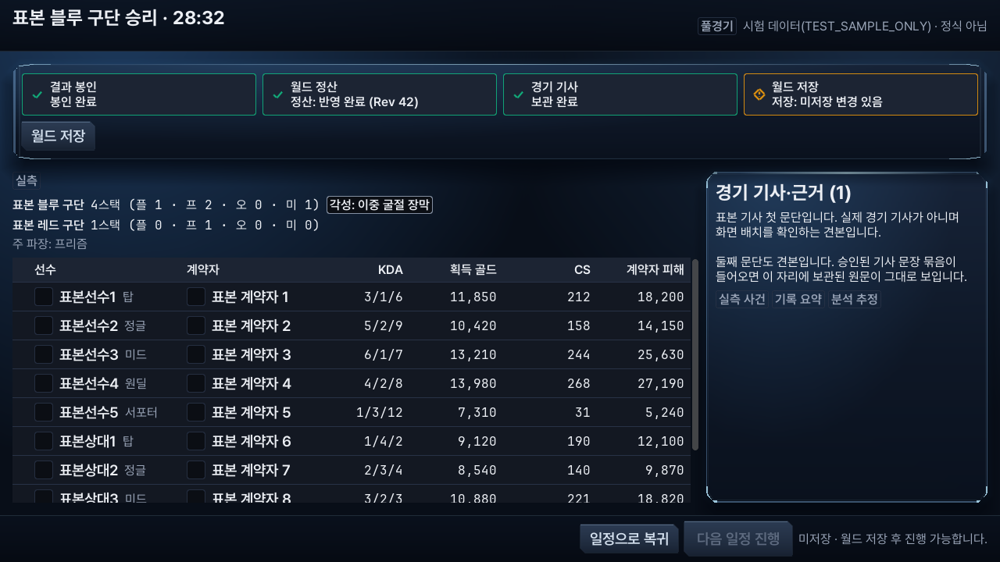</a><figcaption><h3>경기 결과 · 미저장 안내 (작은 창)</h3><time datetime="2026-11-27">2026-11-27</time>
1280×720 100% 창에서 같은 미저장 상태를 찍었습니다. 작은 창에서도 잠금 사유가 단추 옆 한 줄에 들어가는지 보는 화면입니다. 표본 기록이라 실제 경기 결과가 아닙니다. 만든 담당이 직접 찍은 화면이며 독립 시각 검수는 아직 받지 않았습니다.
</figcaption></figure><figure class="shot"><a href="assets/result-save-refused-720.png">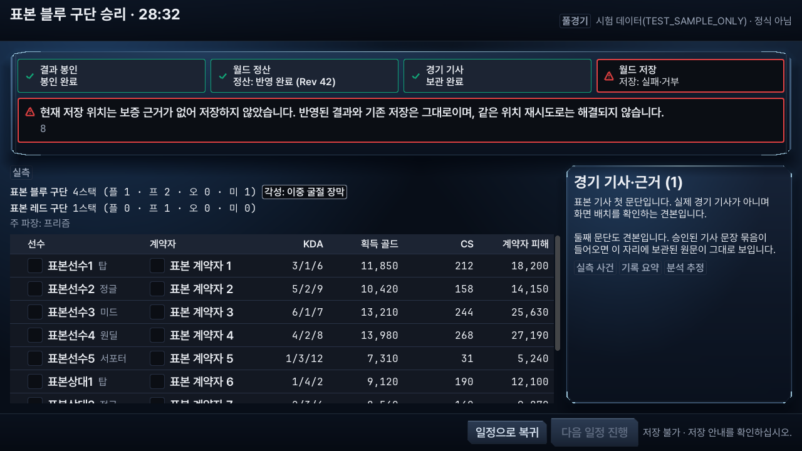</a><figcaption><h3>경기 결과 · 저장 위치 거부</h3><time datetime="2026-11-27">2026-11-27</time>
1280×720 100% 결과 화면에서 저장 위치를 보증할 근거가 없어 저장이 거부된 경우입니다. 같은 위치에서 다시 시도해도 해결되지 않으므로 재시도 단추를 내지 않습니다. 표본으로 만든 거부 상황이며 실제 저장 실패 기록이 아닙니다. 만든 담당이 직접 찍은 화면이며 독립 시각 검수는 아직 받지 않았습니다.
</figcaption></figure><figure class="shot"><a href="assets/result-write-failed-720.png">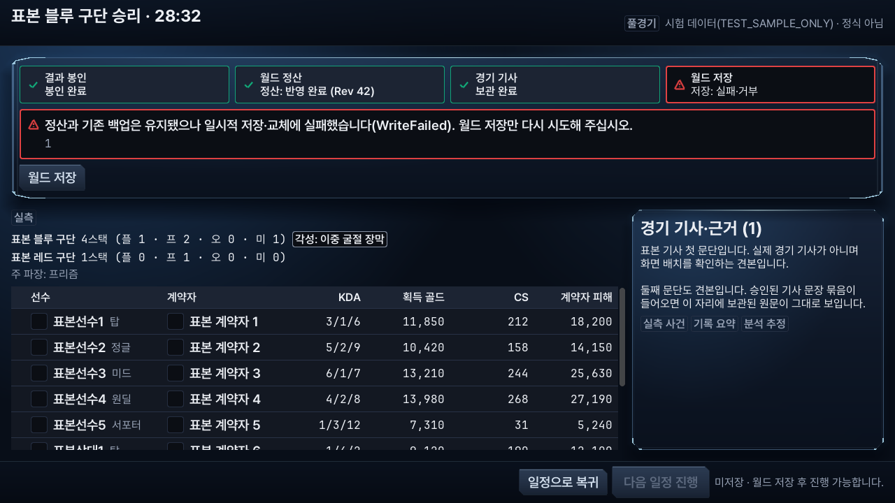</a><figcaption><h3>경기 결과 · 저장 쓰기 실패</h3><time datetime="2026-11-27">2026-11-27</time>
1280×720 100% 결과 화면에서 저장을 한 번 시도했다가 일시적인 쓰기 실패가 난 경우입니다. 정산과 백업은 남아 있어 같은 위치에서 월드 저장만 다시 누르면 됩니다. 표본으로 만든 실패 상황이며 실제 저장 기록이 아닙니다. 만든 담당이 직접 찍은 화면이며 독립 시각 검수는 아직 받지 않았습니다.
</figcaption></figure><figure class="shot"><a href="assets/hud-leader-split-1080.png">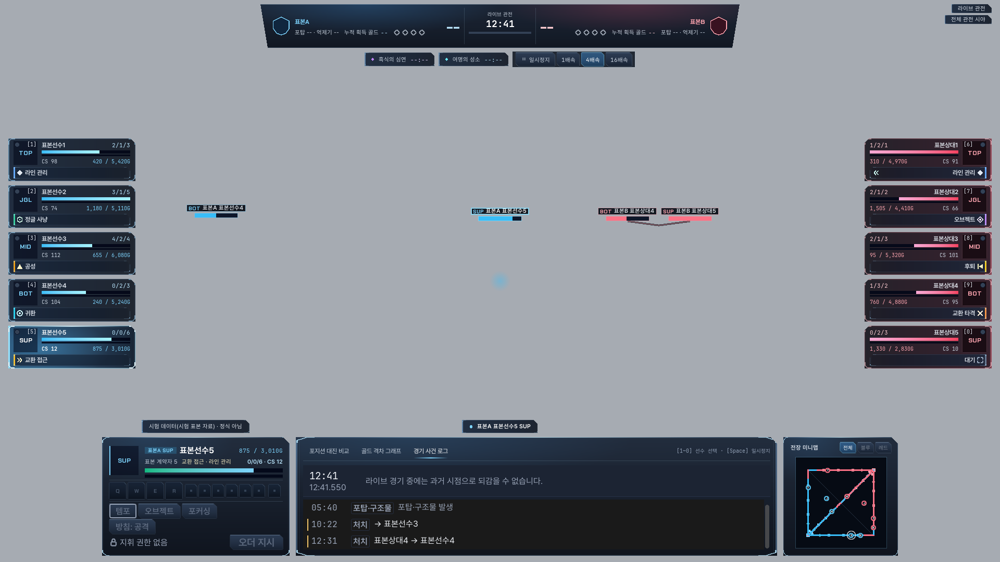</a><figcaption><h3>관전 HUD · 한 점에 선 두 선수의 지시선</h3><time datetime="2026-11-27">2026-11-27</time>
1920×1080 100%로 지시선만 다시 그린 재생 창입니다. 한 점에 선 레드 두 선수의 판이 같은 열에 쌓이지 않고 좌우로 갈라져 각자 선으로 자기 위치를 가리킵니다. 실제 경기에서 잰 투영점을 단색 바탕 위에 옮긴 것이라 3D 장면은 없고, 이름과 체력은 표본 값입니다. 만든 담당이 직접 찍은 화면이며 독립 시각 검수는 아직 받지 않았습니다.
</figcaption></figure><figure class="shot"><a href="assets/hud-leader-split-720.png">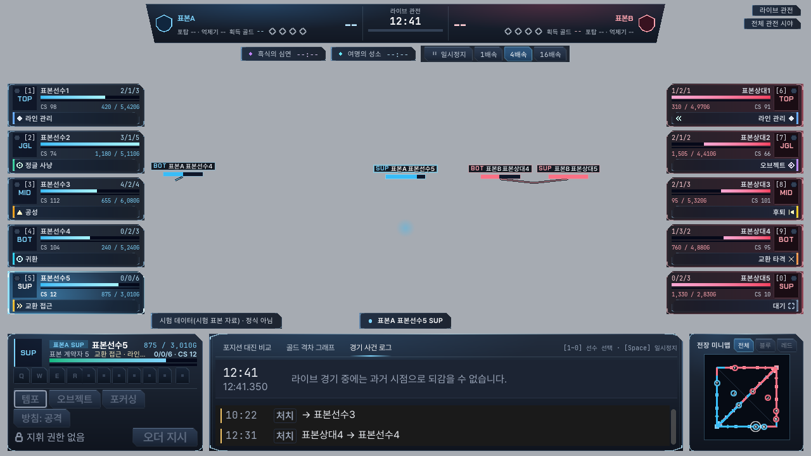</a><figcaption><h3>관전 HUD · 갈라진 지시선 (작은 창)</h3><time datetime="2026-11-27">2026-11-27</time>
1280×720 100% 창에서 같은 투영점을 그렸습니다. 판이 작아져도 두 선수의 판이 겹치지 않고 각자 지시선을 가지는지 보는 화면입니다. 3D 장면이 없는 재생 창이며 이름과 체력은 표본 값입니다. 만든 담당이 직접 찍은 화면이며 독립 시각 검수는 아직 받지 않았습니다.
</figcaption></figure><figure class="shot"><a href="assets/reentry-draft-1080.png">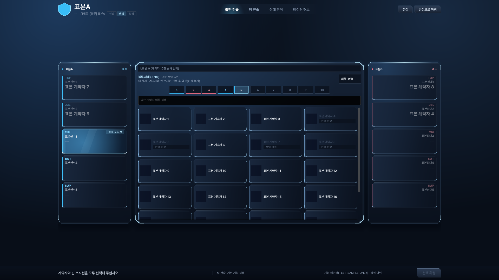</a><figcaption><h3>같은 경기 다시 열기 · 픽 단계</h3><time datetime="2026-11-26">2026-11-26</time>
1920×1080 100%입니다. 픽을 하나 고른 뒤 홈으로 나갔다가 같은 경기를 다시 열었을 때, 처음부터 시작하지 않고 그 픽이 남은 5번째 차례로 돌아오는지 보는 화면입니다. 표본 경기라 실제 경기 진행의 증거가 아닙니다. 만든 담당이 직접 찍은 화면이며 독립 시각 검수는 아직 받지 않았습니다.
</figcaption></figure><figure class="shot"><a href="assets/reentry-draft-720.png">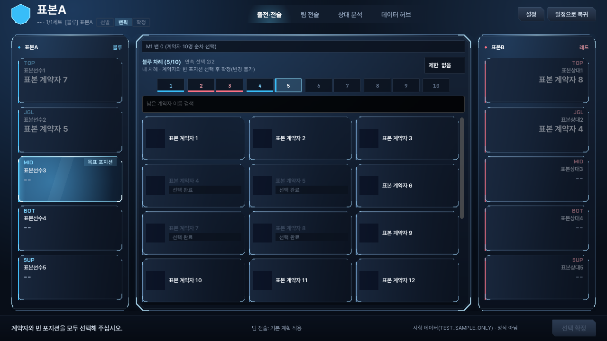</a><figcaption><h3>같은 경기 다시 열기 · 픽 단계 (작은 창)</h3><time datetime="2026-11-26">2026-11-26</time>
1280×720 100% 창에서 같은 재입장 상태를 찍었습니다. 앞서 고른 픽과 차례가 그대로 이어집니다. 표본 경기라 실제 경기 진행의 증거가 아닙니다. 만든 담당이 직접 찍은 화면이며 독립 시각 검수는 아직 받지 않았습니다.
</figcaption></figure><figure class="shot"><a href="assets/reentry-live-1080.png">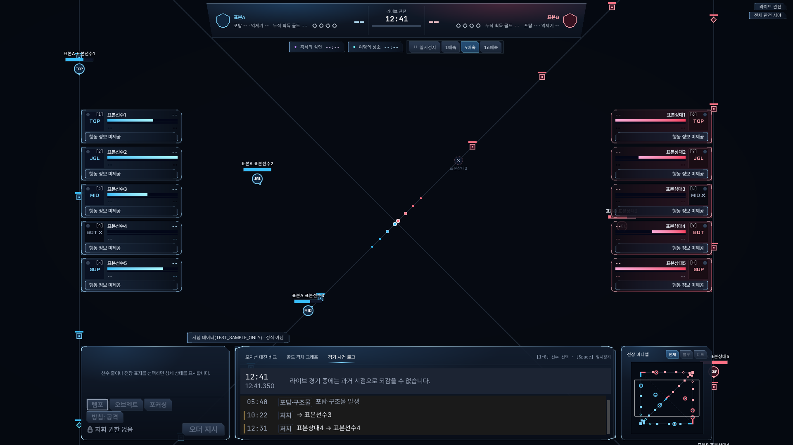</a><figcaption><h3>같은 경기 다시 열기 · 진행 중 관전</h3><time datetime="2026-11-26">2026-11-26</time>
1920×1080 100%입니다. 진행 중인 경기에 다시 들어오면 준비 화면을 거치지 않고 같은 경기의 관전 화면이 열립니다. 3D 장면은 표본이라 끄고 2D 대체 화면으로 찍었습니다. 실제 경기 진행의 증거가 아닙니다. 만든 담당이 직접 찍은 화면이며 독립 시각 검수는 아직 받지 않았습니다.
</figcaption></figure><figure class="shot"><a href="assets/reentry-live-720.png">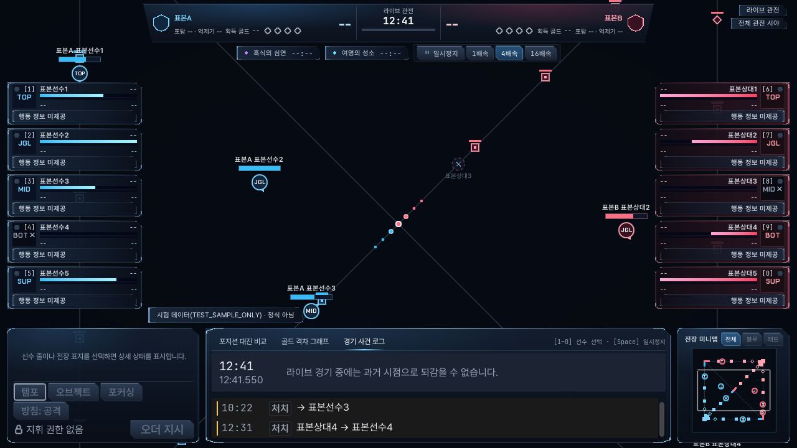</a><figcaption><h3>같은 경기 다시 열기 · 진행 중 관전 (작은 창)</h3><time datetime="2026-11-26">2026-11-26</time>
1280×720 100% 창에서 같은 진행 중 재입장을 찍었습니다. 3D 장면 대신 2D 대체 화면입니다. 표본 경기라 실제 경기 진행의 증거가 아닙니다. 만든 담당이 직접 찍은 화면이며 독립 시각 검수는 아직 받지 않았습니다.
</figcaption></figure><figure class="shot"><a href="assets/reentry-unconnected-1080.png">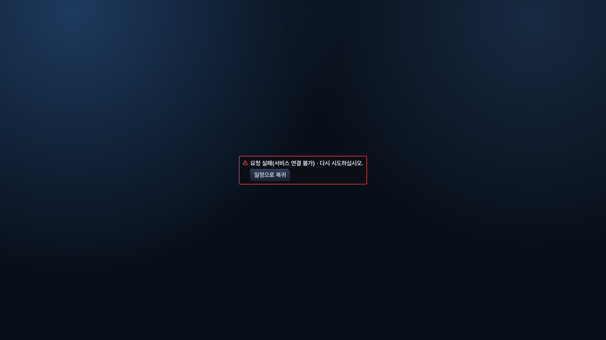</a><figcaption><h3>같은 경기 다시 열기 · 서비스 연결 없음</h3><time datetime="2026-11-26">2026-11-26</time>
1920×1080 100%입니다. 다시 열 지점에 필요한 서비스가 없으면 다른 화면을 대신 열지 않고 이 안내와 복귀 단추만 보입니다. 기존 안내 양식과 문구를 그대로 썼고, 배치의 실제 화면 검수는 아직입니다. 만든 담당이 직접 찍은 화면이며 독립 시각 검수는 아직 받지 않았습니다.
</figcaption></figure><figure class="shot"><a href="assets/reentry-unconnected-720.png">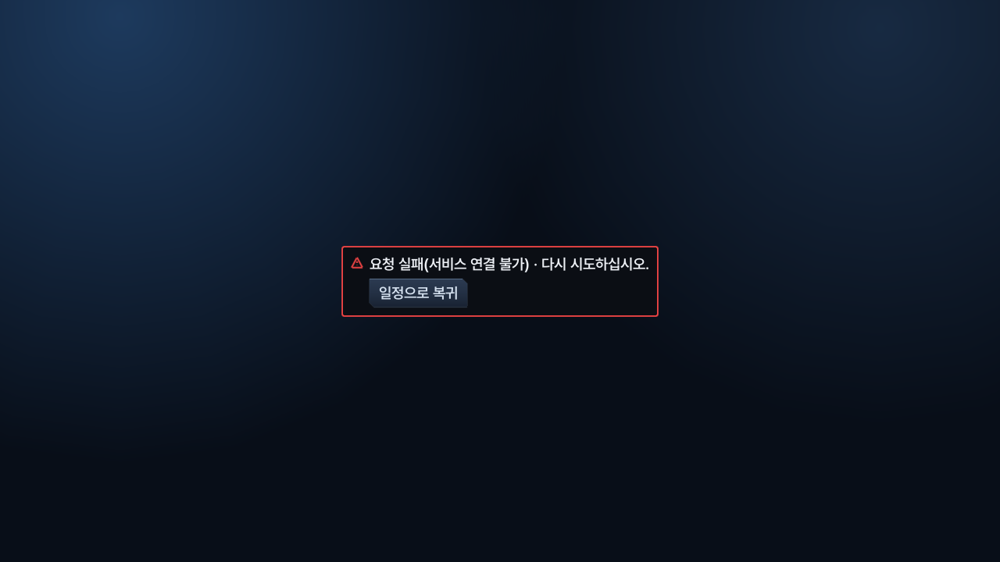</a><figcaption><h3>같은 경기 다시 열기 · 서비스 연결 없음 (작은 창)</h3><time datetime="2026-11-26">2026-11-26</time>
1280×720 100% 창에서 같은 비연결 표시를 찍었습니다. 관전, 준비, 결과 화면 중 어느 것도 열리지 않은 상태입니다. 만든 담당이 직접 찍은 화면이며 독립 시각 검수는 아직 받지 않았습니다.
</figcaption></figure><figure class="shot"><a href="assets/prematch-directive-ask-1080.png">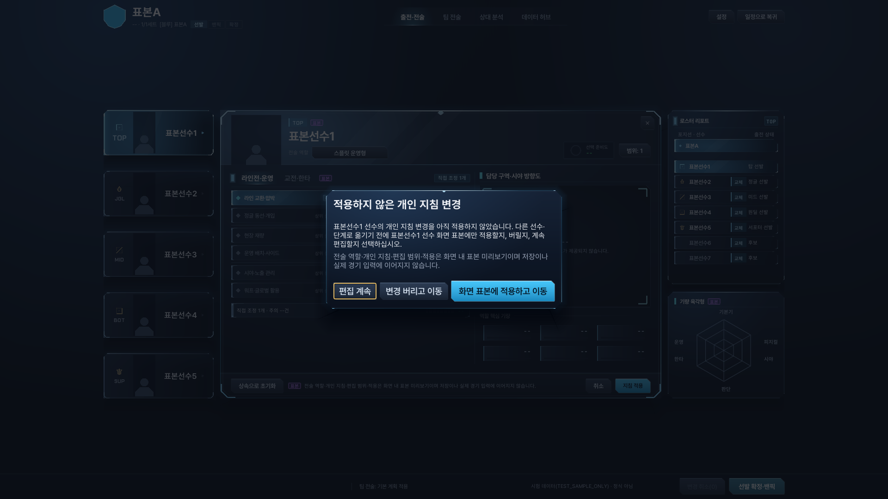</a><figcaption><h3>출전 화면 · 미적용 지침 세 선택</h3><time datetime="2026-11-26">2026-11-26</time>
1920×1080 100%에서 화면에 붙은 지침 창 위로 뜬 확인창입니다. 세 단추가 한 줄에 들어가지 않으면 창 폭을 넓히도록 고친 뒤의 모습입니다. 표본 장면이며 지침은 저장이나 실제 경기 입력으로 이어지지 않습니다. 만든 담당이 직접 찍은 화면이며 독립 시각 검수는 아직 받지 않았습니다.
</figcaption></figure><figure class="shot"><a href="assets/prematch-directive-ask-720-150.png">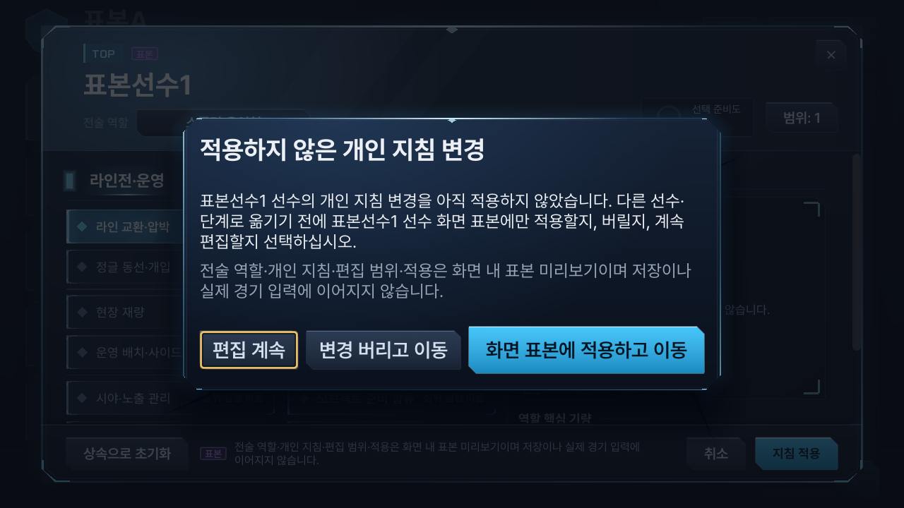</a><figcaption><h3>출전 화면 · 미적용 지침 세 선택 (150%)</h3><time datetime="2026-11-26">2026-11-26</time>
1280×720 창을 150%로 키워 찍었습니다. 지침 창이 화면을 덮는 배치에서도 세 단추가 한 줄로 확인창 안에 들어가는지 보는 화면입니다. 표본 장면이며 지침은 저장되지 않습니다. 만든 담당이 직접 찍은 화면이며 독립 시각 검수는 아직 받지 않았습니다.
</figcaption></figure><figure class="shot"><a href="assets/prematch-v4-directives.png">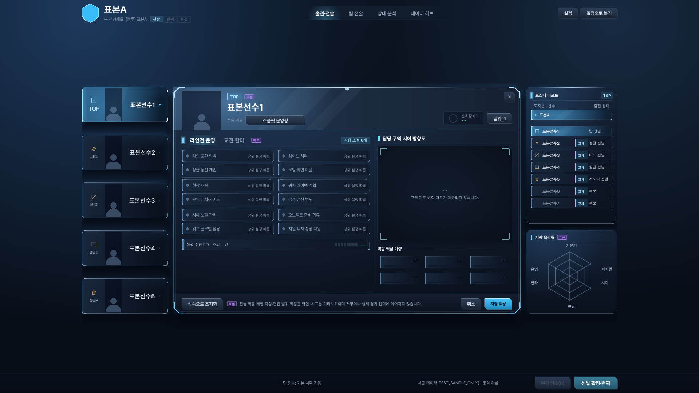</a><figcaption><h3>출전·전술 · 선수 개인 지침 창</h3><time datetime="2026-11-26">2026-11-26</time>
실제 게임 창에서 탑 선수의 개인 지침 창을 연 1920×1080 시험 정지화면입니다. 두 탭 가운데 ‘라인전·운영’ 탭이 열려 있으며, 초상은 미반입 실루엣 대용이고 지도·방향 칸에는 자료 미제공 안내를, 역할 핵심 기량 여섯 칸에는 값 없는 빈 칩을 표시했습니다. 화면 내 표본 미리보기 단계로 실제 저장·경기 입력 반영이나 디자인 최종 승인을 뜻하지 않습니다.
</figcaption></figure><figure class="shot"><a href="assets/prematch-v4-lineup.png">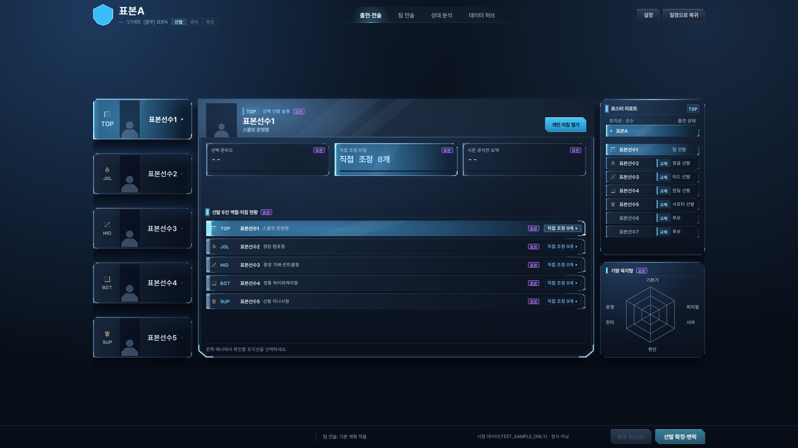</a><figcaption><h3>출전·전술 · 선발 다섯 자리</h3><time datetime="2026-11-26">2026-11-26</time>
게임 창에서 개인 지침 창을 열지 않은 선발 단계의 시험 정지화면으로, 탑 선수를 선택한 모습입니다. 구단·선수 이름은 시험용이고 초상은 미반입 자리표시이며, 값이 없는 준비도·시즌 기록은 대시로, 기량 육각형은 빈 격자로 표시합니다. 실제 입력·저장 동작이나 최종 디자인 확정을 뜻하지 않습니다.
</figcaption></figure><figure class="shot"><figcaption><h3>출전·전술 · 계약자 드래프트</h3><time datetime="2026-11-26">2026-11-26</time>
출전 세 단계 중 두 번째인 드래프트입니다. 블루가 선택할 차례로, 양 팀에서 이미 고른 계약자와 아직 선택할 수 있는 후보를 함께 보여줍니다. 게임 창에서 촬영했으며 선수와 계약자는 표본입니다.
</figcaption></figure><figure class="shot"><figcaption><h3>관전 HUD 중간본 · 전체 관전 시야</h3><time datetime="2026-11-26">2026-11-26</time>
디자인 교정 전 촬영본입니다. 선수 카드의 처치·사망·도움, CS와 골드는 시험용이며 위 5대5 경기의 기록이 아닙니다. 교정한 화면에서는 1920×1080 기본 배율의 점수판·선수 카드·하단 패널 배치를 시안과 대조했습니다. 이 사진은 그 결과를 찍은 것이 아닙니다.
</figcaption></figure><figure class="shot"><a href="assets/hud-spectator-team-vision.png">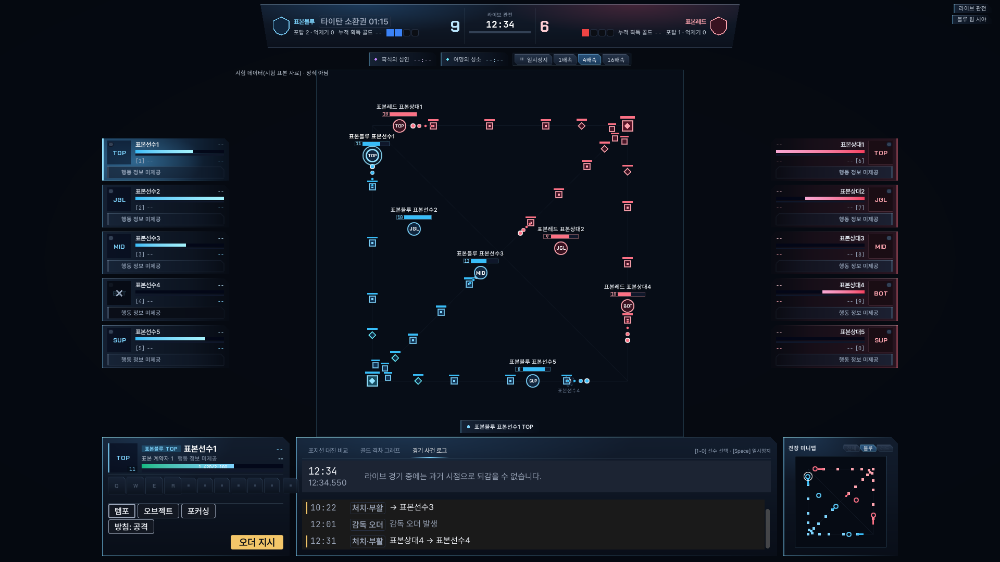</a><figcaption><h3>관전 HUD 중간본 · 블루 팀 시야</h3><time datetime="2026-11-26">2026-11-26</time>
아직 최종 디자인이 아닌 블루 팀 시야의 시험 장면입니다. 선수 기록을 받지 않은 칸은 0으로 채우지 않습니다. 위치와 체력은 전장 자료에서 따로 받아 표시합니다.
</figcaption></figure><figure class="shot"><a href="assets/prematch-before-redesign.png">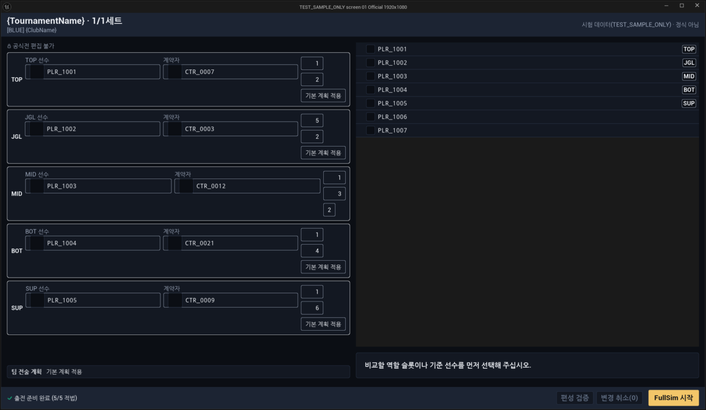</a><figcaption><h3>출전·전술 · 디자인 교정 전</h3><time datetime="2026-11-22">2026-11-22</time>
11월 22일 게임 창에서 표본 선수로 연 편성 화면입니다. 이후 받은 디자인 시안을 적용하기 전 모습입니다. 현재 드래프트는 위의 11월 26일 사진에서 볼 수 있습니다.
</figcaption></figure><figure class="shot"><a href="assets/spectator-scoreboard.png">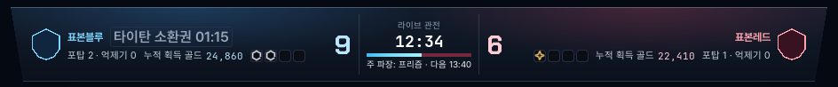</a><figcaption><h3>관전 점수판</h3><time datetime="2026-11-25">2026-11-25</time>
1920×1080 관전 HUD에서 점수판만 잘라냈습니다. 소환권 표지가 처치 수와 시계를 가리지 않는지 살피는 시험 장면으로, 위 경기의 기록은 아닙니다.
</figcaption></figure><figure class="shot"><a href="assets/spectator-player-card.png">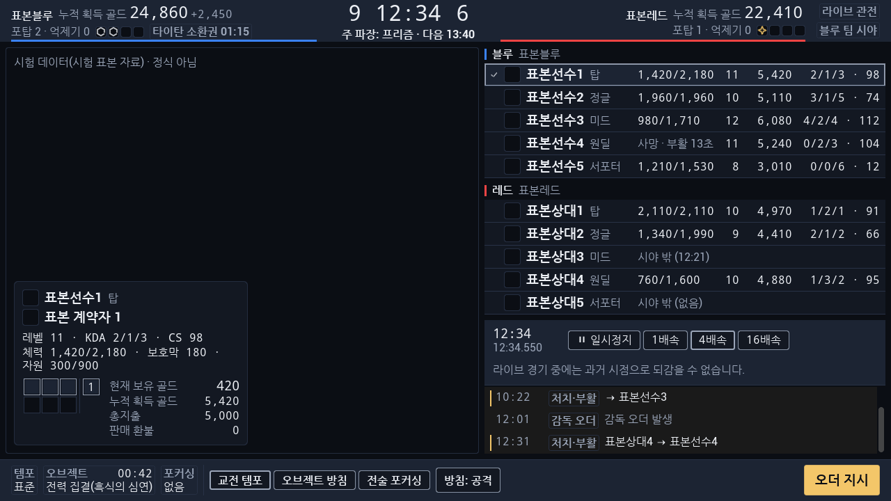</a><figcaption><h3>선수 카드 · 보유 골드와 지출</h3><time datetime="2026-11-25">2026-11-25</time>
1280×720 관전 창에 표본 선수의 카드를 펼쳤습니다. 장비 칸과 골드 내역을 살피는 화면이라 전장은 비어 있습니다. 실제 경기의 구매 기록은 아닙니다.
</figcaption></figure><figure class="shot"><figcaption><h3>경기 결과 · 선수별 기록</h3><time datetime="2026-11-25">2026-11-25</time>
1920×1080 결과 창에 시험용 기록과 견본 기사를 띄웠습니다. 상단에는 정산은 끝났지만 아직 저장하지 않았다고 표시됩니다. 앞선 5대5 경기의 결과표는 아닙니다.
</figcaption></figure>
</section>
