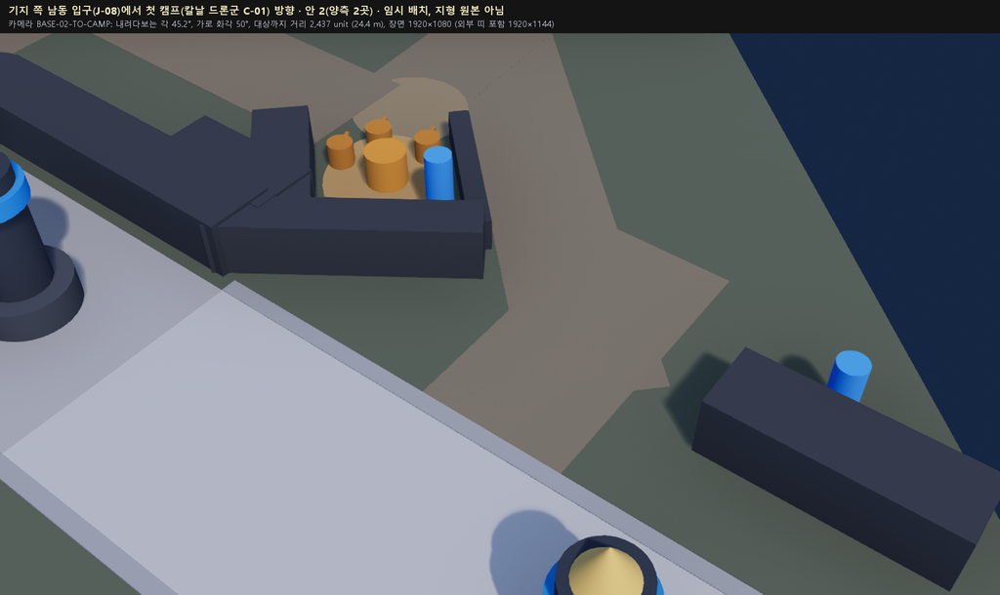
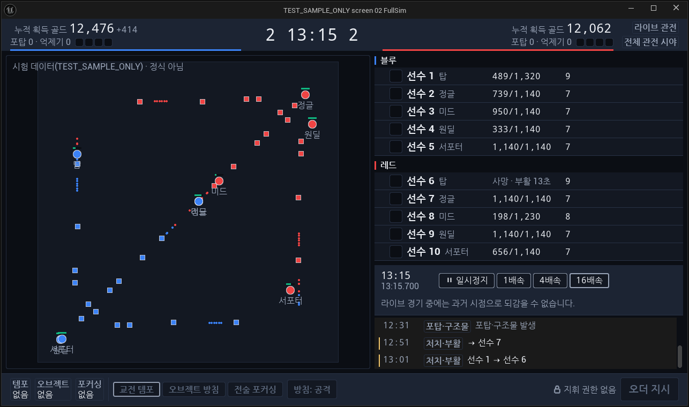
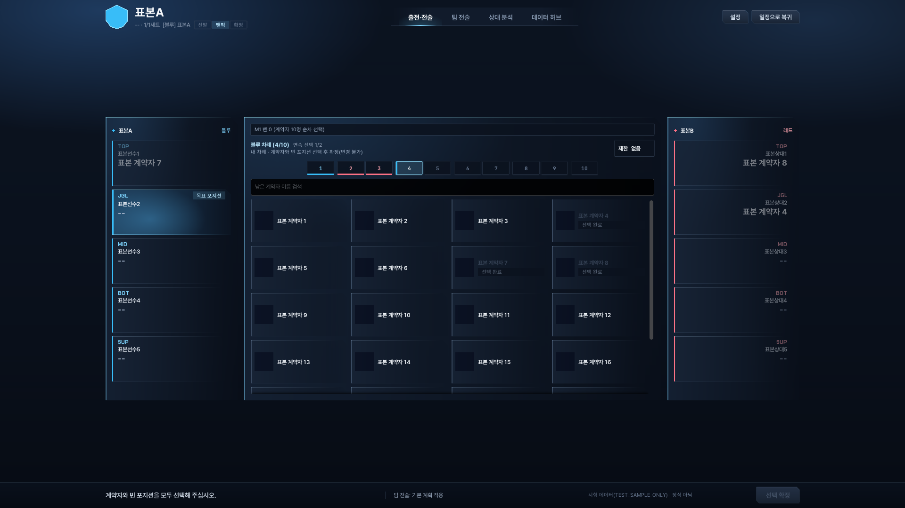
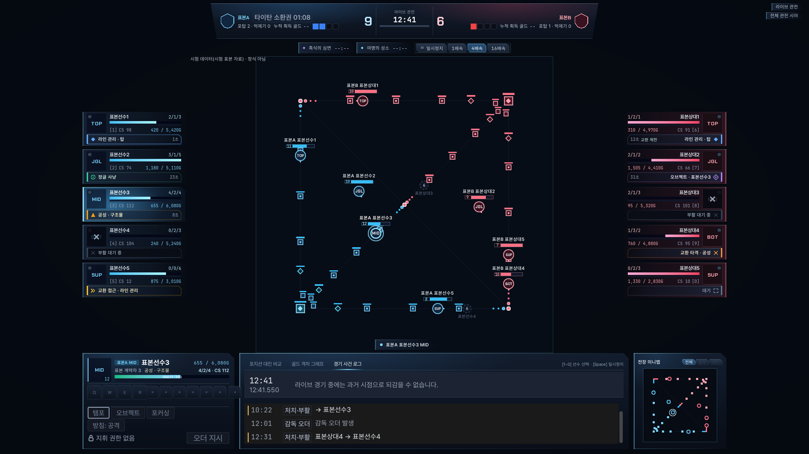
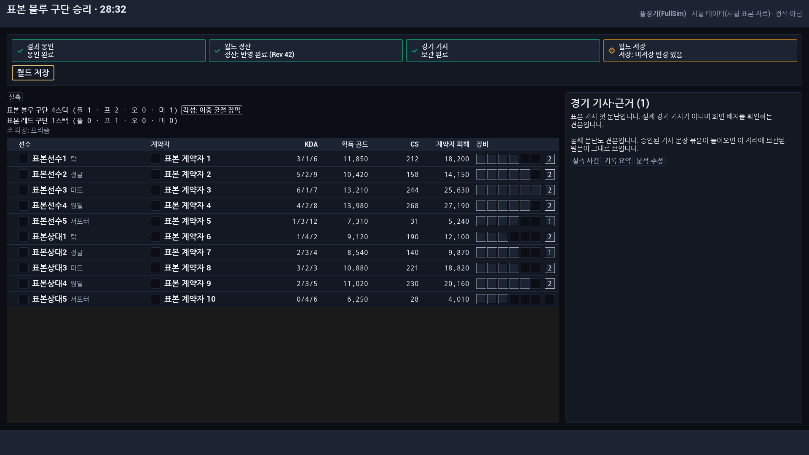

# LumenCross 작업 현황판

홈페이지: https://ju00moon-sketch.github.io/LumenCross/

LumenCross(루멘 크로스) 개발 진행을 대표와 팀이 한곳에서 보기 위한 정적 페이지입니다. 페이지는 손으로 고른 공개용 자료에서 생성하며, 이 저장소의 파일을 직접 고치지 않습니다.

페이지 상단에서 다음 내용을 선택할 수 있습니다.
- `index.html`: 작업 현황. 지금 하는 일만 둡니다: 역할별 활동, 대표가 보실 것의 건수와 가는 길, 기준선과 저장소 상태(아직 안 된 것, 기준 문서 버전, 다음 단계), 레인별 작업 현황, 열린 반례.
- `review.html`: 기획 검토. 대표를 기다리는 것을 모두 둡니다: 대표가 답하실 것, 총괄이 정해 보고하는 것, 새로 받은 기획의 검토(요약, 쟁점·총괄 반박·게임디자인 의견·합의, 최종안, 확인받을 항목).
- `closed.html`: 완료·종결. 끝난 것을 모두 둡니다: 완료한 작업, 답변으로 종결된 대표 결정, 총괄이 정리해 닫은 보고, 답변이 끝난 기획 검토, 종결된 반례, 검증 기록, 변경 기록.
- `contractors.html`: 계약자 도감. 지역별 계약자와 병과, 스킬 기획.
- `items.html`: 아이템 백과. 아이템별 가격과 효과, 아이콘 제작 목록, 남은 기획.
- `art.html`: 아트. 중간 보고, 제작한 그림·동작과 회전·확대할 수 있는 3D 모델.
- `screenshots.html`: 게임 화면. 미러시티 구조물 배치와 구간별 근접 사진, 경기 관전, UI·HUD 촬영본을 구분합니다. 이미지를 선택하면 원본 크기로 볼 수 있습니다.

기계용 요약은 `status.json`입니다. 작업 현황 탭은 공개 저장소의 최신 `activity.json`에서 역할별 상태와 마지막 활동 시각을 1분마다 읽습니다. 활동만 바뀌면 게임 이미지·모델이나 사이트 전체를 다시 배포하지 않습니다. 보고와 에셋은 검토 후 별도로 게시합니다.

규칙
- 탭은 실제 링크이며 키보드 Enter, 뒤로 가기, 직접 주소 열기를 지원합니다.
- 대표의 답을 기다리는 질문은 기획 검토 탭의 대표가 답하실 것 칸 한곳에만 둡니다. 결정 자료는 질문, 추천안과 이유, 대안, 플레이 차이, 구현·다른 설계 영향, 결정 시점, 숫자 상태의 7항목으로 적습니다.
- 대표가 실제로 답한 결정과 검토만 답변과 함께 완료·종결 탭의 답변 칸으로 옮깁니다. 일이 끝났거나 뒤 카드로 대체된 총괄 결정 보고는 총괄이 닫은 까닭을 적어 따로 둔 칸으로 옮기며 대표의 답으로 적지 않습니다. 열린 항목은 완료·종결 탭에 나오지 않고, 종결된 항목은 다른 탭에 나오지 않습니다.
- 읽음 표시는 이 브라우저에만 저장되는 표시이며 답변이나 승인이 아닙니다. 열린 항목이 없으면 읽음 단추와 안 읽음 배지를 그리지 않습니다.
- 검증 기록에는 실제로 실행한 것만 적고, 확인한 범위를 함께 적습니다. 범위에 없는 것은 확인하지 않은 것입니다.
- 비어 있는 칸은 비어 있다는 문장으로 보이며, 자리만 채우는 카드는 만들지 않습니다.
- 근거 표는 1000px 이상에서는 표로, 그보다 좁은 화면에서는 행마다 열 이름이 붙은 카드로 보입니다.
- 화면 밝기는 기기의 밝은 화면·어두운 화면 설정을 따릅니다.
- 레인 이름은 역할 이름만 씁니다. 작업 PC의 경로, 사용자 이름, 전자우편 주소, 작업·메시지 식별자, 작업 도구의 제품 이름은 공개하지 않으며, 생성기가 이런 내용을 찾으면 페이지를 쓰지 않고 멈춥니다.

배포는 `.github/workflows/pages.yml`이 저장소 루트를 그대로 올리는 방식입니다.

## 게임 화면

<section id="mirror-city" aria-labelledby="mirror-city-h"><h2 id="mirror-city-h">미러시티 전경6장</h2>
<figure class="shot"><figcaption><h3>레드 탑 라인 · 억제기와 3차 포탑</h3><time datetime="2026-11-26">2026-11-26</time>
레드 탑 라인의 기지 쪽 두 구조물을 옆에서 찍었습니다. 높은 3차 포탑과 낮은 억제기의 위치 관계를 보여주는 사진이며, 이 구간에는 아직 길과 벽이 없습니다.
</figcaption></figure><figure class="shot"><figcaption><h3>미드 1차 포탑에서 본 정글 입구와 여울</h3><time datetime="2026-11-26">2026-11-26</time>
블루 1차 포탑 뒤에서 강가를 향해 찍었습니다. 팀 포탑은 실제 모델이고, 길·암벽·수풀·첫 캠프는 위치와 통로 폭을 확인하는 임시 형상입니다.
</figcaption></figure><figure class="shot"><figcaption><h3>미드 길에서 강가까지 · 관전 시점</h3><time datetime="2026-11-25">2026-11-25</time>
게임 엔진에서 미러시티의 미드 구간을 관전 카메라로 찍었습니다. 원기둥은 계약자, 상자는 드론의 자리를 나타냅니다. 완성 모델을 배치한 경기 장면은 아닙니다.
</figcaption></figure><figure class="shot"><figcaption><h3>포탑 사이로 갈라지는 정글 입구 · 위에서 본 모습</h3><time datetime="2026-11-25">2026-11-25</time>
기지 쪽 정글 입구를 추가한 11월 25일의 구간 촬영입니다. 당시 대리 포탑 둘 사이에서 길이 갈라져 첫 캠프와 여울로 이어지는 모습을 위에서 볼 수 있습니다.
</figcaption></figure><figure class="shot"><figcaption><h3>남동 정글 입구에서 본 첫 캠프</h3><time datetime="2026-11-25">2026-11-25</time>
미드 1차와 2차 포탑 사이에서 남동쪽을 바라본 장면입니다. 정글에 들어설 때 첫 캠프가 어디에 보이는지 확인하려고 찍었습니다. 주황색 표시는 드론 모델이 아닙니다.
</figcaption></figure><figure class="shot"><figcaption><h3>강을 건너는 여울과 양쪽 강둑</h3><time datetime="2026-11-25">2026-11-25</time>
미드 길에서 강을 건너는 자리를 관전 카메라로 찍었습니다. 두 줄의 돌판 사이가 여울이고, 강둑의 초록 상자는 수풀이 놓일 자리입니다.
</figcaption></figure>
</section>
<section id="spectating" aria-labelledby="spectating-h"><h2 id="spectating-h">경기 관전2장</h2>
<figure class="shot"><figcaption><h3>전장 전체 · 13:15, 처치 2 대 2</h3><time datetime="2026-11-25">2026-11-25</time>
기본 공격만 쓰는 5대5 시험 경기를 관전 창에서 찍었습니다. 선수 이름은 표본이지만 위치와 체력, 부활 대기 시간은 경기에서 계산한 값입니다.
</figcaption></figure><figure class="shot"><figcaption><h3>26:58 · 경기 종료</h3><time datetime="2026-11-25">2026-11-25</time>
같은 경기의 마지막 장면입니다. 두 팀이 다섯 번씩 처치했고 레드가 이겼습니다. 이 시험에서는 3D 전장 대신 위치 표지를 썼습니다.
</figcaption></figure>
</section>
<section id="interface" aria-labelledby="interface-h"><h2 id="interface-h">UI·HUD7장</h2>
<figure class="shot"><figcaption><h3>출전·전술 · 계약자 드래프트</h3><time datetime="2026-11-26">2026-11-26</time>
출전 세 단계 중 두 번째인 드래프트입니다. 블루가 선택할 차례로, 양 팀에서 이미 고른 계약자와 아직 선택할 수 있는 후보를 함께 보여줍니다. 게임 창에서 촬영했으며 선수와 계약자는 표본입니다.
</figcaption></figure><figure class="shot"><figcaption><h3>관전 HUD 중간본 · 전체 관전 시야</h3><time datetime="2026-11-26">2026-11-26</time>
디자인 교정 전 촬영본입니다. 선수 카드의 처치·사망·도움, CS와 골드는 시험용이며 위 5대5 경기의 기록이 아닙니다. 교정한 화면에서는 1920×1080 기본 배율의 점수판·선수 카드·하단 패널 배치를 시안과 대조했습니다. 이 사진은 그 결과를 찍은 것이 아닙니다.
</figcaption></figure><figure class="shot"><figcaption><h3>관전 HUD 중간본 · 블루 팀 시야</h3><time datetime="2026-11-26">2026-11-26</time>
아직 최종 디자인이 아닌 블루 팀 시야의 시험 장면입니다. 선수 기록을 받지 않은 칸은 0으로 채우지 않습니다. 위치와 체력은 전장 자료에서 따로 받아 표시합니다.
</figcaption></figure><figure class="shot"><figcaption><h3>출전·전술 · 디자인 교정 전</h3><time datetime="2026-11-22">2026-11-22</time>
11월 22일 게임 창에서 표본 선수로 연 편성 화면입니다. 이후 받은 디자인 시안을 적용하기 전 모습입니다. 현재 드래프트는 위의 11월 26일 사진에서 볼 수 있습니다.
</figcaption></figure><figure class="shot"><figcaption><h3>관전 점수판</h3><time datetime="2026-11-25">2026-11-25</time>
1920×1080 관전 HUD에서 점수판만 잘라냈습니다. 소환권 표지가 처치 수와 시계를 가리지 않는지 살피는 시험 장면으로, 위 경기의 기록은 아닙니다.
</figcaption></figure><figure class="shot"><figcaption><h3>선수 카드 · 보유 골드와 지출</h3><time datetime="2026-11-25">2026-11-25</time>
1280×720 관전 창에 표본 선수의 카드를 펼쳤습니다. 장비 칸과 골드 내역을 살피는 화면이라 전장은 비어 있습니다. 실제 경기의 구매 기록은 아닙니다.
</figcaption></figure><figure class="shot"><figcaption><h3>경기 결과 · 선수별 기록</h3><time datetime="2026-11-25">2026-11-25</time>
1920×1080 결과 창에 시험용 기록과 견본 기사를 띄웠습니다. 상단에는 정산은 끝났지만 아직 저장하지 않았다고 표시됩니다. 앞선 5대5 경기의 결과표는 아닙니다.
</figcaption></figure>
</section>
